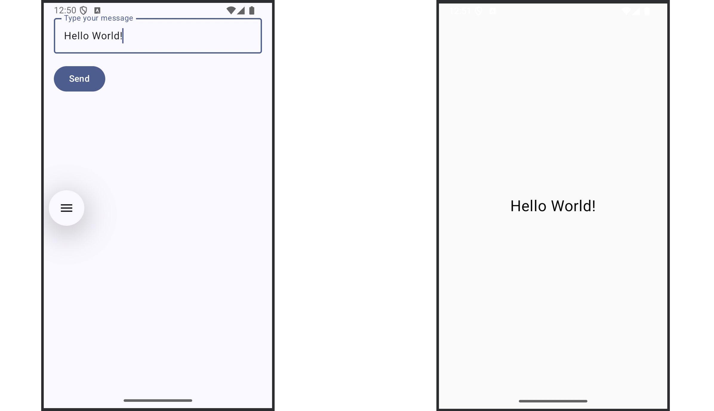

# EINF/DET/ISPTEC 2026/2027


# Aplicações Móveis


# Laboratório 2 - Parte 2


# Introdução ao Android e ao Kotlin


#### 


---


#### Objectivos:


Nesta segunda parte do segundo laboratório pretendemos introduzir o desenvolvimento de aplicações Android usando **Android Studio Panda 3 (2025.3.3 Patch 1)** e o **Kotlin**. No fim deste laboratório o estudante deve ser capaz de:


* Entender a estrutura de um projecto Android usando o Kotlin.
* Configurar e executar uma aplicação no emulador ou em um dispositivo físico.
* Criar e navegar entre actividades.
* Construir layouts de UI simples usando o Jetpack Compose..
* Gerir entrada do utilizador e eventos básicos.
* Usar o Logcat e debugger do Android Studio.
* Construir uma aplicação de lista de tarefas simples.

---

## 
 Exercício I – Hello Android (Duas Actividades)


Neste exercício, construirá uma aplicação Android básica composta de duas actividades (mostrada na Figura 1). A primeira actividade, apresentada quando a aplicação é lançada, terá uma entrada de texto e um botão "Enviar". Quando o utilizador escrever um texto e pressionar o botão, a segunda actividade será lançada e apresenta o texto inserido primeira actividade. This is your own variant of a "Hello World" application.



**Figure 1:** Actividades implementadas pela aplicação "Hello Android".

O exercício é devido em:
 - **1.1:** Criar o projecto Android e entender sua estrutura.
 - **1.2:** Testar a aplicação no emulador ou dispositivo físico.
 - **1.3:** Construir a segunda actividade e conectar com a primeira.


Ao concluir os pontos anteriores, fica familiarizado com o ciclo de vida básico da aplicação, os blocos de construção da interface do utilizador, o tratamento da entrada do utilizador e a navegação entre actividades.

---


#### 1.1. Criar o projecto Android e entender sua estrutura


1. Abrir o Android Studio.
2. Seleccionar **"New Project" > "Empty Activity"**.
3. Configure o seguinte:
    * **Name**: `HelloAndroid`
    * **Language**: Kotlin
    * **Minimum SDK**: API 24 ou superior
4. Clica em **Finish** para criar o projecto.


**a. Explore a estrutura do projecto:**  Navegue pelo projecto na visão **Project** (não na visão **Android**) e descreva a função dos seguintes ficheiros (Sugestão: leia ["Projects overview"](https://developer.android.com/studio/projects)):

 * `app/src/main/java/.../MainActivity.kt`
* `app/src/main/AndroidManifest.xml`
* `build.gradle.kts` (project and module level)


**b. Gerir o Emulator:** executar sua aplicação no emulador Android:
 1. Abrir o **Device Manager** no Android Studio (toolbar > Device Manager).
 2. Clicar **"Create Device"** e escolha o modelo de telemóvel (por exemplo, Pixel 6).
 3. Escolha a imagem do sistema (por exemplo, API 34) e clique **Next**.
 4. Configure as opções pretendidas e clique em Concluir.
 5. Inicia o emulador pressionando o ícone verde.


**c. Execução em dispositivo físico (Opcional):** para executar a aplicação no seu telemóvel:
 1. Conecta o seu dispositivo Android ao seu computador via USB.
 2. Habita **Developer Options** em seu despositivo:
 - Vá para Settings > About Phone > presssione "Build Number" sete vezes.
 - Volta para Settings > System > Developer Options.
 - Habilite **USB Debugging**.
 3. O seu dispositivo deve aparecer no menu suspenso Executar. Clique o botão **Run** para instalar.


**Referências:** [Create your first Android app](https://developer.android.com/codelabs/basic-android-kotlin-compose-first-app), [Run apps on a hardware device](https://developer.android.com/studio/run/device)


---


#### 1.2. Logging e Feedback


Antes de prosseguir com a implementação da aplicação completa com duas actividades, aprenda a monitorizar e depurar a sua aplicação.


**a. Mensagens do Logcat** em `MainActivity.kt`, adiciona a seguinte linha dentro do método `onCreate()`:


```kotlin

  Log.d("MainActivity", "Aplicação iniciada com sucesso.")
```

Também inclui:


```kotlin

  import android.util.Log
```

Abra a aba **Logcat** do Android Studio para visualizar os logs. Filtra pelo nome da sua aplicação ou pela tag.


**b. Mensagem de notificação (Toast):** Adicione uma notificação (toast) para confirmar cliques nos botões, substituindo o conteúdo da função `Greeting()` como se segue:


```kotlin

  val context = LocalContext.current

  Box(
      modifier = Modifier
          .fillMaxSize(),
      contentAlignment = Alignment.Center
  ) {
      Button(
          onClick = {
              Toast.makeText(context, "O botão foi clicado.", Toast.LENGTH\_SHORT).show()
          }
      ) {
          Text("Clique-me!")
      }
  }
```

Vai precisar incluir as seguintes bibliotecas:


```kotlin

  import android.widget.Toast
  import androidx.compose.foundation.layout.Box
  import androidx.compose.material3.Button
  import androidx.compose.ui.platform.LocalContext
```

1. Confirme se este código cria um botão e apresenta uma mensagem Toast quando é clicado.
2. Adicione também uma mensagem de log após a mensagem toast e visualize-a no Logcat.


> 
> **Pergunta:** Onde posso configurar como os logs são filtrados no Logcat?
> 
> 
> 


**Referência:** [Documentação do Logcat](https://developer.android.com/studio/debug/logcat)


---


#### 1.3. Criar uma Segunda Actividade (Jetpack Compose)


Neste passo vai concluir a aplicação "Hello Android" usando o **Jetpack Compose**. A aplicação vai permitir o utilizador digitar uma mensagem e clicar o botão **Enviar**, que vai lançar a segunda actividade que apresenta a mensagem digitada na primeira actividade.


**a. Extender a UI em `MainActivity.kt`:** O modelo de projecto já utiliza o Jetpack Compose. Substitua ou modifique o componente de `Greeting` predefinido para criar um ecrã que inclua:


* Um `OutlinedTextField` para colectar dado do utilizador.
* Um `Button` que mostra um `Toast`, logs a mensagem digitada usando `Log.d(...)`, e inicie a segunda actividade usando uma `Intent`.


Use `remember` para armazenar e actualizar o texto introduzido pelo utilizador e use `LocalContext.current` para lançar a nova actividade.


**b. Cria a segunda actividade:**
* No Android Studio, clique com o botão direito do rato no nome do seu pacote e escolha **New > Activity > Empty Views Activity**.
* Nomeie por `DisplayMessageActivity`.
* Em `DisplayMessageActivity.kt`, adaptar o modelo para a classe `DisplayMessageActivity` herdar de `ComponentActivity()`
*  Extende `DisplayMessageActivity` para recuperar a mensagem usando `intent.getStringExtra("EXTRA_MESSAGE")`.
* Use Compose para apresentar esta mensagem usando um `Text` composable.


**c. Declare a actividade no manifesto:** certifique-se de que `DisplayMessageActivity` está declarado no seu `AndroidManifest.xml` dentro da tag `<application>`.


**Código de amostra:**


**No `MainActivity.kt`:**


```kotlin

  import android.widget.Toast
  import androidx.compose.foundation.layout.Column
  import androidx.compose.foundation.layout.Spacer
  import androidx.compose.foundation.layout.fillMaxWidth
  import androidx.compose.foundation.layout.height
  import androidx.compose.material3.Button
  import androidx.compose.material3.OutlinedTextField
  import androidx.compose.runtime.mutableStateOf
  import androidx.compose.runtime.remember
  import androidx.compose.runtime.getValue
  import androidx.compose.runtime.setValue
  import androidx.compose.ui.platform.LocalContext
  import androidx.compose.ui.unit.dp
```


```kotlin

  val context = LocalContext.current
  var text by remember { mutableStateOf("") }

  Column(
      modifier = Modifier
          .padding(16.dp)
          .fillMaxWidth()
  ) {
      OutlinedTextField(
          value = text,
          onValueChange = { text = it },
          label = { Text("Type your message") },
          modifier = Modifier.fillMaxWidth()
      )

      Spacer(modifier = Modifier.height(16.dp))

      Button(
          onClick = {
              Toast.makeText(context, "Botão clicado!", Toast.LENGTH\_SHORT).show()
              Log.d("MainActivity", "Utilizador digitou a mensagem: $text")
              val intent = Intent(context, DisplayMessageActivity::class.java).apply {
                  putExtra("EXTRA_MESSAGE", text)
              }
              context.startActivity(intent)
          }
      ) {
          Text("Send")
      }
  }
```

**No `DisplayMessageActivity.kt`:**


```kotlin

  val message = intent.getStringExtra("EXTRA_MESSAGE") ?: "Nenhuma mensagem recebida."

  setContent {
      HelloAndroidTheme {
          Box(
              contentAlignment = Alignment.Center,
              modifier = Modifier.fillMaxSize()
          ) {
              Text(text = message, fontSize = 24.sp)
          }
      }
  }
```


> 
> **Perguntas:**
> 1. Qual o papel do objecto `Intent` nesta aplicação?
> 2. Qual o papel de `remember` e `mutableStateOf`?
> 3. Porquê precisamos do `LocalContext.current` num composable para iniciar uma actividade?
> 
> 
> 
> 


**Referência:** [Introdução as actividades](https://developer.android.com/guide/components/activities/intro-activities)


---


### Exercício 2 – Introdução ao Kotlin


Esta secção apresenta o Kotlin, a linguagem moderna recomendada pela Google para o desenvolvimento Android. Se vem do mundo Java, o Kotlin oferece:


* Sintáxe concisa
* Segurança de valor nulo
* Recursos funcionais como lambdas e operações de colecção
* Funções de extensão
* Classes de dados e tipos selados

---


#### 2.1. Básico do Kotlin: Variáveis, Controlo de fluxo, e Segurança de valor nulo


Actualiza o `DisplayMessageActivity.kt` para realizar processamento adicional na mensagem. Divida a mensagem em palavras individuais e conte-as.


**Tarefas**
1. Declare e atribua variáveis ​​utilizando `val` (imutável) e `var` (mutável).
2. Utilize a manipulação de strings em Kotlin para dividir a string de entrada numa lista de palavras.
3. Implemente controlo de fluxo básico (`if`, `when`) para gerar uma resposta dependendo do número de palavras.


**Exemplo de excerto de código Kotlin**

```kotlin

  val words = message?.split(" ") ?: listOf()
  val wordCount = words.size

  val summary = when {
      wordCount == 0 -> "Nenhuma palavra encontrada!"
      wordCount == 1 -> "Apenas uma palavra!"
      else -> "Foram digitadas $wordCount palavras."
  }
```


> 
> **Pergunta:** Como seria essa mesma lógica em Java? O que significa `?.split()` ? O que faz o operador `?:`?
> 
> 
> 


---


#### 2.2. Classes de Dado e Operações de Lista


Crie uma nova classe Kotlin chamada `PalavraBundle` que encapsula a lista de palavras e calcula algumas estatísticas sobre a mesma. (por exemplo, contagem total, comprimento médio das palavras, palavra mais longa).


**Tarefas**
1. Crie um ficheiro `PalavraBundle.kt`.
2. Use uma `data class` com uma propriedade: `val palavras: List<String>`.
3. Adicione métodos (ou propriedades computadas) para retornar:
    * Contagem total de palavras
    * Comprimento médio da palavra
    * A palavra mais longa


**Exemplo de excerto de código Kotlin**

```kotlin

 data class PalavraBundle(val palavras: List) {
      val contar = palavras.size
      val comprimentoMedio = palavras.map { it.length }.average()
      val palavraMaisLonga = palavras.maxByOrNull { it.length } ?: "Não disponível."
 }
```


> 
> **Pergunta:** Porque é que `maxByOrNull` é preferido a `maxBy` em Kotlin? O que faz `?: "Não disponível"`?
> 
> 
> 


---


#### 2.3. Funções e Lambdas


Mover a lógica para calcular o resumo para uma função de nível superior (fora de qualquer classe). Utilize lambdas Kotlin para filtrar a lista de palavras com base no comprimento.


**Tarefas**
1. Escreva uma função `fun gerarSumario(bundle: PalavraBundle): String`.
2. Dentro dele, filtre palavras com um comprimento superior a um limite predefinido usando uma expressão lambda.
3. Retorna uma string resumida incluindo todas as estatísticas.


**Exemplo de excerto de código Kotlin**

```kotlin

  fun gerarResumo(bundle: PalavraBundle): String {
      val palavrasLongas = bundle.palavras.filter { it.length > 4 }
      return "Palavras: ${bundle.count}, Comprimento médio: ${bundle.averageLength},
        Palavras longas: ${palavrasLongas.joinToString()}"
  }
```


> 
> **Pergunta:** Qual é o tipo da função lambda passada para `filter`? Qual a diferença entre esta e uma classe anónima em Java?
> 
> 
> 


---


#### 2.4. Kotlin Orientado a Objectos e Funcional


Agora actualize a sua classe `DisplayMessageActivity` para usar a classe e função já escritas.


1. Pegue na string da Intent, divida-a e construa uma `PalavraBundle`.
2. Gera a string resume e apresente em um composable `Text`.


Pode substituir a mensagem de eco original por esta saída mais rica e processada.


**Exemplo de excerto de código Kotlin**

```kotlin

  val palavras = mensagem.split(" ").filter { it.isNotBlank() }
  val bundle = PalavraBundle(palavras)
  val resumo = gerarResumo(bundle)
```


> 
> **Pergunta:** Onde armazenaria classes auxiliares como `PalavraBundle` em um grande projecto Android? (Veja o Guia de Desenvplvedores Android em  [Arquitectura de Aplicação](https://developer.android.com/topic/architecture) Para recomendações sobre como organizar a sua aplicação em pacotes como `ui`, `data`, `domain`, e `util`)
> 
> 
> 


---


**Referências:**


* [Aprenda a linguagem de programação Kotlin](https://developer.android.com/kotlin/learn)
* [Guia de estilo do Kotlin](https://developer.android.com/kotlin/style-guide)
* [Referência da linguagem Kotlin](https://kotlinlang.org/docs/reference/)
* [Parque infantil do Kotlin](https://play.kotlinlang.org/)


---


... Desafio será adicionado breve....


---


